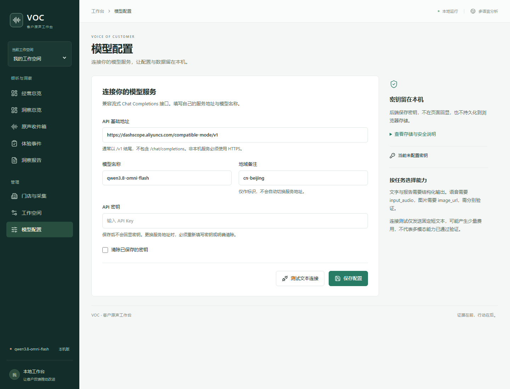
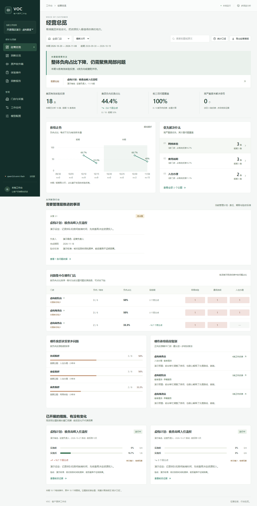

# VOC · 客户原声决策平台

**让客户的真实声音，成为改进决策的依据。**

[English](README.en.md) · [快速开始](#快速开始) · [模型配置](public-docs/model-configuration.md) · [安全说明](SECURITY.md) · [Apache-2.0](LICENSE)

VOC 是面向酒店、餐饮、零售及服务业的开源客户原声工作台。它将分散的语音与文字反馈，整理为可追溯的体验事件、趋势和行动建议，帮助团队从“收到一条投诉”走向“理解问题并验证改进”。

项目采用旁路洞察思路：先从独立采集入口或导出的资料开始，不要求替换现有 CRM、工单或 BI。本仓库提供本机运行版本，适合产品验证、行业试点和二次开发。

> 当前版本是单机研究与试点工具，不是直接开放到公网的多租户SaaS。没有账号认证与租户权限体系；请仅绑定回环地址，处理真实反馈前确认授权和模型服务的数据政策。

## 工作台预览





## 能做什么

| 能力 | 实现方式 |
| --- | --- |
| 收集客户原声 | 上传录音、浏览器录音、粘贴文字，按门店生成采集链接与二维码 |
| 理解多语言反馈 | 使用配置的模型转写与分析；保留原语言转写，以中文展示摘要和建议 |
| 直达原始证据 | 从事件和报告回到原文与实际音频片段，核对客户究竟说了什么 |
| 整理体验事件 | 提取主题、情绪、严重度与建议，支持人工确认、排除、负责人及跟进记录 |
| 看清跨店差异 | 对比周期、门店、客群和议题，查看正向体验与优先处理的问题 |
| 生成洞察报告 | 保存生成时的数据快照和有效事件引用，导出Markdown报告 |
| 观察改进效果 | 关联行动计划及前后窗口，显示分子、分母和样本限制，不把前后差异当作因果 |
| 配置自己的模型 | 本机页面设置API地址、模型ID和密钥，支持保存及文本连接测试 |

图片附件的存储、证据展示和模型处理已实现，但当前公开UI没有通用图片上传表单；可通过数据接入扩展。不要把后端具备的能力当成已经完善的业务入口。

## 快速开始

### 1. 准备环境

- Python 3.11或更高版本。
- Node.js 22.12或更高版本，及npm。
- FFmpeg与ffprobe，加入系统PATH；文字功能不依赖音频转换，音频处理及完整测试需要它们。
- 你有权使用的模型服务及API密钥。真实调用可能收费。

### 2. 安装

```bash
git clone https://github.com/zbpan/voc.git
cd voc/app
python -m venv .venv
```

Windows PowerShell激活环境：

```powershell
.\.venv\Scripts\Activate.ps1
```

macOS或Linux激活环境：

```bash
source .venv/bin/activate
```

安装依赖并启动：

```bash
python -m pip install -r requirements.txt
npm ci
npm run build
python run.py
```

打开 **http://127.0.0.1:8765**。新安装默认工作空间为空，不自动下载模型或导入数据。

### 3. 配置模型并开始分析

进入侧栏 **模型配置**，填写API基础地址、模型名称及密钥。先测试文本连接，再保存配置，然后添加一条文字反馈验证结构化分析。

默认配置以Qwen多模态服务为起点，也可以填写其他提供流式Chat Completions的服务。**文字协议兼容不代表语音、图片或结构化输出一定兼容。** 语音要求模型接受`input_audio`，图片要求接受`image_url`；更换模型后请用对应素材验证。[配置详情](public-docs/model-configuration.md)

## 不配置密钥也能体验页面

在仓库根目录执行：

```bash
python examples/seed_demo.py
```

在页面切换到“开源酒店演示 · 虚构数据”。脚本只向独立演示空间写入36条原创虚构文字样例和明确标记的预置结果，**不调用模型，不包含第三方图片或音频**。它用于看板和证据交互演示，不是模型效果测试；你仍需配置服务来分析新反馈。

如果设置了`VOC_DATA_DIR`，导入脚本与应用使用相同数据目录。脚本重复运行不会覆盖已有演示空间。

## 设计与技术

```text
语音 / 文字 / 门店采集
          ↓
FastAPI → 本机SQLite与原始文件 → 持久化任务队列
          ↓
音频分段 → 模型理解 → 引文核对 → 体验事件
          ↓
React工作台 → 人工复核 / 经营总览 / 洞察报告
```

| 部分 | 技术 |
| --- | --- |
| 前端 | React、Vite、Lucide |
| 后端 | FastAPI、Pydantic、httpx |
| 数据 | SQLite、独立媒体目录、报告生成时快照 |
| 音频 | FFmpeg/ffprobe、实际分段范围回听 |
| 模型 | 流式Chat Completions，默认Qwen配置，用户提供密钥 |

不需要独立数据库服务，也不把模型密钥打包到前端。配置页保存的密钥以**本机明文文件**存放在数据目录，接口不回传密钥；本仓库通过忽略规则排除这些文件。操作系统账户与磁盘保护仍由部署者负责。

## 统计与能力边界

- 反馈数不等于事件数，也不等于住客人数；同一条反馈可以包含多个事件。
- 负向占比包含“负向”和“褒贬并存”，分母是已完成且包含体验反馈的记录，不是入住量。
- 音频以120秒连续片段分析，回听定位是实际片段范围，不是字级时间戳。
- 左右声道由用户选择；混合声道角色识别不等于专业说话人分离。
- 高严重度信号可能待人工复核，不应直接转换为员工扣分或事故定论。
- 没有入住量、收入及实验数据时，不推算经营损失、NPS或ROI，也不承诺入住率提升。
- 当前是单worker、本机访问模式。工作空间是整理单位，不是安全隔离的租户边界。
- 未内置全渠道爬虫、CRM接口、权限分级、数据脱敏、支付或收费模块。

## 开发与测试

在`app/`目录运行：

```bash
python -m pip install -r requirements-dev.txt
python -m pytest tests -q
npm run build
```

开发前端使用`npm run dev`，后端使用`python run.py`。普通API可通过Vite代理访问；**模型配置页出于同源限制，请使用构建后由后端提供的8765页面**。

自动测试使用隔离临时目录与模拟模型，不需要真实密钥。真实模型与多模态质量仍需部署者用已授权材料验证。GitHub Actions运行后端测试和前端构建。

## 项目结构

```text
app/src/       React工作台
app/voc/       API、模型适配、队列、数据和经营聚合
app/tests/     接口、证据、统计和模型配置安全测试
examples/      原创虚构文字演示生成器
public-docs/   公开配置说明、截图与架构说明
.github/       CI与协作模板
```

## 参与与许可

欢迎提交问题复现、行业场景、模型兼容性测试和改进代码。提交前阅读[贡献指南](CONTRIBUTING.md)，不要上传客户录音、个人信息或密钥。安全问题请先阅读[安全说明](SECURITY.md)。

本项目原创代码和公开示例采用 **Apache License 2.0**。第三方依赖保留各自许可；外部模型、服务和用户上传内容不由本项目许可证重新授权。公开版本不包含本地研究缓存、历史数据库、凭据、私钥或许可尚未确认的多媒体演示包。
